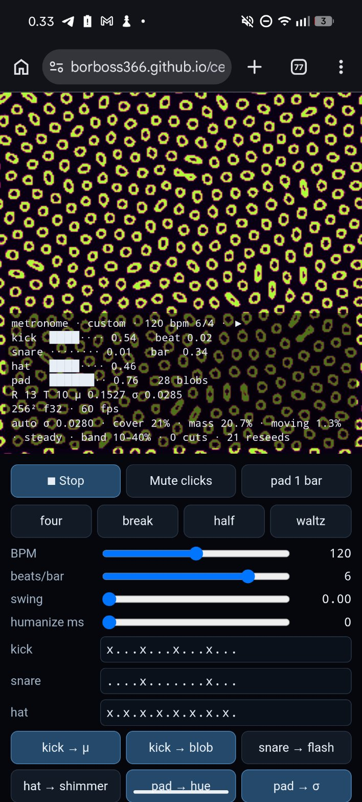

# Cellular-viz lab notes

Repo: github.com/borboss366/cellular-viz · Live: https://borboss366.github.io/cellular-viz/
Rule (user, 2026-10-21): never delete experiments; Lab Notes logs everything done.

## Best presets (only ones marked keep)
_None yet. No screenshot verdicts posted._

## Project log
- 2026-10-21 · Project started: single-file WebGL experiments for phone. Researcher asked for top-5 CA variants; Dev to start 01 Gray-Scott; Lab Notes to keep this log.
- 2026-10-21 · 01 Gray-Scott built and merged (PR #1, 293502e). 512×512 wrap grid, 10 steps/frame, presets coral / mitosis / worms / fingerprint, finger drawing, f/k/steps/brush/shading sliders, params + fps overlay. Live at experiments/01-gray-scott.html.
- 2026-10-21 · Researcher list: 4 picks (Gray-Scott excluded as built). Pick for 02 = Lenia Orbium (R13 T10 μ0.15 σ0.015), ref github.com/AtsuyaTsuchida/lenia-webgl, start 256². Fallback: cyclic CA. Beat sync plan: AnalyserNode bass flux → pulse uniform.
- 2026-10-21 · User: "Lets go with the dev suggestion" → 02 = Lenia Orbium; beat sync to be its own 03 (not built yet).
- 2026-10-21 · 02 Lenia built (PR #2, merged 881959b). 256² grid, 1 step/frame, presets orbium (5 gliders) / swarm (16) / soup / bloom, R/T/μ/σ sliders, paint/erase, fading trail, params + fps overlay. Live at experiments/02-lenia.html.
- 2026-10-21 · User on 02: "Looks good. But it occupies the screen very fast and then it is static." Researcher: plain Lenia has no mass conservation; soup (σ 0.016) and bloom (σ 0.020) fill the grid then freeze.
- 2026-10-21 · User decision: try all three perpetual routes in order — (1) patch 02 with stagnation reseed + σ governor, (2) Flow Lenia, (3) Particle Lenia. "Lets do it."
- 2026-10-21 · Researcher: Flow Lenia defaults θ_A=1, n=2, dt 0.2, s 0.65, search radius 5; reference uses 10 kernels up to radius 25 (too heavy for phone) → start with 1–3 kernels, R ≤ 13.
- 2026-10-21 · User asked for one-tap copy of the setup. Dev added a **Copy setup** button to 01 and 02 (PR #3, merged 6bd91c2): copies experiment · preset, all params, grid, fps, time since reset, and a link that reopens the settings (fresh random seed, so not the same picture).
- 2026-10-21 · User asked to keep this log on GitHub too → notes/cellular-viz-log.md in borboss366/cellular-viz (Pages: notes/cellular-viz-log.html). Lab Notes pushes updates.
- 2026-10-21 · 03 audio-reactive Lenia merged (PR #4 was empty by mistake; files came in PR #5, 9459ea1). Orbium defaults R13 T10 μ0.15 σ0.015, polynomial growth; audio from Mic or File; bass beat pulse → flash/glow, μ nudge, blob inject (toggles); BPM via realtime-bpm-analyzer; `?size=512` option. Live at experiments/03-lenia-audio.html.
- 2026-10-21 · 04 Lenia on a metronome merged (PR #6, 4196e98). Built-in Web Audio clock: BPM 60–180 (120), beats/bar 2–7, swing, humanize, grooves four/break/half/waltz; kick → μ / blob, snare → flash, hat → shimmer, pad → hue drift / σ ±0.001. Live at experiments/04-lenia-metronome.html.
- 2026-10-21 20:38 · User asked for links to review. None of 01–04 browser-tested by Dev yet.
- 2026-10-22 · User reviewed 02 (entry below): still fills the background; "reviewing the other pages would make more sense". User: "Lets work with the metronome lenia for a while, as i see it has potential. Also i did not know i can draw on it."
- 2026-10-22 · Step 1 done: 02 Auto mode (PR #7): σ lowered when crowded, back up when sparse, 2 Orbiums dropped after 3 s still; info line `auto σ … · mass … · moving …`.
- 2026-10-22 · 04 draw hint "Draw with a finger · two fingers erase" (PR #8). User: "Lets add auto mode" to 04.
- 2026-10-22 · 04 Auto mode + controls panel fix on all pages (PR #9); Auto measures cover and cuts holes on the downbeat when crowded (PR #10); reseeds with a noisy blob too (PR #11); page scrolls as a whole for in-app viewers (PR #12); cover band sliders (refill below 10%, thin above 40%) + short info box (PR #13).
- 2026-10-22 · User screenshot: 04 on raw.githack preview filled with worms (old copy without Auto). Shot: shots/2026-10-22-04-githack-preview-worms.jpg
- 2026-10-22 · User screenshot: 04 live page stuck on "loading…". Cause: variable declared twice; fixed in PR #14. Shot: shots/2026-10-22-04-stuck-loading.jpg
- 2026-10-22 · User: 04 custom (from four) "All filled up" (entry below). Cause: cover counted lit cells, so a ring field read 21%; fixed in PR #15 (cover = share of 16×16 patches with anything lit; < 2.5% moving counts as still).
- 2026-10-22 · User on 04 after PR #15: "It creates quite cool effect when it clears out. But it takes a lot of time for orbitals to produce new filling again and screen feels empty." → PR #16: refill speed slider 1–5 (default 3 = 3 Orbiums + 2 blobs every 1.3 s), batches land on the kick, σ snaps back when refilling, thinning stops 10 points below "thin above".
- 2026-10-22 · User on 04: "this one looks more or less nice, lots of fine tuning though". Moved on to Flow Lenia.
- 2026-10-22 · Step 2 done: 05 Flow Lenia (PR #17). Mass-conserving; presets calm / blobs / cells / fizz; 🎲 Randomize (μ, σ); drag stirs, Touch toggles paint, Erase; View: mass or flow direction; info shows total mass. Not yet reviewed by user.
- 2026-10-23 · Researcher effects list for Lenia: bloom (kick-pumped), emboss + sheen, cosine palettes on pad, MilkDrop-style trails, kick bulge.
- 2026-10-23 · New bot visualisation QA joined. QA harness qa/harness.html + qa/04, qa/05, qa/06 index folders (PR #18): records 12 s .webm per variant, measures coverage / motion / beat / colour / fps, scores 0–10.
- 2026-10-23 · 06 Lenia + effects (PR #19, bf80aa0): copy of 04 with bloom, emboss, sheen, palette, trail zoom, trail length, kick bulge sliders; bloom-on-kick and palette-drift toggles; looks clean / glow (default) / chrome / dream / pulse; Copy setup has an `fx …` line. 04 unchanged.
- 2026-10-23 · User installed Termux so QA can run headless sweeps.
- 2026-10-24 · User: visualisers needn't be cellular automata; the main target is a powerful laptop at DJ sets, the phone is a bonus. Millennium-problem track (#37), 09 Riemann first: phase portrait of ζ(s) (Borwein η + functional equation in logs, per pixel), travel/overview camera, metronome-driven, fullscreen (branch exp-09-riemann).
- 2026-10-24 · QA box check (hue winding on a 1080p screenshot): zeros 14.13/21.02/25.01, trivial zeros and pole correct, 60 fps; left half black above height ~29. Cause: sin(πs/2) overflowed float32 inside the functional equation. Fixed by computing log sin directly (and a scaled complex log).
- 2026-10-25 · User graded 09 (run 2026-10-24-1958): travel beats overview, kept as default. The left-half-black fix (e08422d) was never re-checked on its own; branch riemann-height-60 lets ?height go to 60 (held with speed=0 or paused) so QA box can sweep Im s 0–60 for black regions.
- 2026-10-24 · User on 09: correct but dull; maths pages should be art first, still true. VIZ research's v2 spec (#37). Built as a new page, 11 Riemann show (branch exp-11-riemann-show, 09 kept as the calm baseline): ribbon chase-cam, zero march, Z(t) scope over the beat's waveform, primes from the explicit formula (one zero per beat, staircase at the drop), canyon over log|ζ|, plus 09's map; zeros land on downbeats; scenes switch every 8 bars with a fade.
- 2026-10-25 · QA box vs LMFDB: 11's maths all correct (38/38 zeros, ribbon and scope cross at them, primes within 0.44), 60 fps, but auto and primes froze on frame 1: the first rAF timestamp is older than clockStart, so bars < 0 (scene index −1, prime count −1). Fixed: bars clamped at 0, and the loop books the next frame first and survives a throwing frame.
- 2026-10-25 · User's 11 picks: ribbon (3–0) > scope > canyon > march > map > primes (0–3); "canyon needs to be more alive, like pulses on the surface". Canyon now sends rings out of every zero pit on each beat (bigger on the downbeat), glowing in the surface's phase colour and bending the light, with the valley breathing on the kick, snare bands and hat twinkle (branch riemann-canyon-pulses). The terrain itself stays log|ζ|.
- 2026-10-25 · User: "pulsating bumps on the surface" (spec on #37). The rings now lift the ground (0.32·ring, swelling on the kick, hat goosebumps), faded to zero within 1.2 units of each zero so the pits stay exact (branch riemann-canyon-bumps).
- 2026-10-25 · QA box on #42: all checks pass, but calibrated beat sync showed light ~65 ms and bumps ~95 ms late (target ≤ 40) and GPU headroom halved (146 → 69 fps). Cause of the lag: rings were born at the pit and hidden by the damping for ~0.2 beat. Now born at radius 1.2, and the march skips the ring sum when the ray is far above the ground.
- 2026-10-25 · QA box on #42 @e43e0df: canyon headroom about halved (p99 33.5 ms uncapped), since near the ground every march step still paid 8 zeros × 3 exp. Now the ring lift is baked once a frame into a 512×1024 world-space texture (x −20…20, z tc−8…tc+64) and the march reads it; the refine (8 bisections from the last step above), the normal and the glow keep the exact ring sum. Target ≥ 100 fps uncapped.
- 2026-10-25 · QA box, canyon uncapped at 1080p on the Radeon 780M, all builds back to back in one session: main f0979e9 338 fps (p99 6 ms), 4106047 93 fps (p99 29 ms), 74c71ca 155 fps (p99 13.6 ms); 60 fps with vsync and no frame over 20 ms on all three. The earlier "main 141" overlapped another GPU job and is void. The look matches 4106047 (≤ 0.16% of pixels differ). User merged #42 (7b220eb).
- 2026-10-25 · User on 17: "it is about the path … can we do more complicated paths of the ramp, even if not accurate within BSD?" VIZ research's Skate Park spec (#37 comment 6396657302). Built as a new page, 19 Skate Park (branch exp-19-skate-park): torus (the complex curve is a torus; the rail is a (p,q) torus knot, (2,3) → (3,5) → (5,8) per section, 24-torsion beads lit per beat), morph (y² = x³ − 3x + b, b 0 → 2 over the build-up so Δ = 0 and the egg pinches into the main branch at the node (1, 0) on the drop; the rider loops the egg and rides through the node), free (Fourier coaster with corkscrews and banked turns, "inspired by"). Slow glide (0.35 units/beat), camera 1.1 behind and 0.35 above the rail, 2-bar tricks only at section changes and drops, 16-bar sections, 17's mod-p city below.
- 2026-10-25 · User: tricks too often and too fast, ~4× slower. 19 gets 17's trick schedule: trickOn sections (drop + section change, never overlapping; the morph's drop stays the merge), bars or drops, trickEvery 16, trickSpeed 0.25 (a 2-bar hang takes 8 bars); glideSpeed 0.5 units/beat replaces speed; a section change outside a trick is a low 1-bar transfer.
- 2026-10-25 · BSD final (6 picks): 19 wins, free ≈ torus > morph > 17 x³−2x (17 lost 3–0). User: "yes merge" → #50 merged; 19 is the BSD page.
- 2026-10-25 · QA box correction: 11's beat clock is already the heard clock (currentTime − outputLatency), so subtracting the latency again double-counted. Real: canyon kick flare ~65 ms after the sound (fails ≤ 40), ribbon zero flashes ~5–15 ms after (passes; #47 closed). The canyon now reads the drums 40 ms ahead from the metronome's look-ahead (?canyonLead=ms to tune), and the page logs every drum hit and zero flash as window.__qa.events {type, tBeat, tHeard, perfHeard, perfDrawn, lead} so moving-camera scenes are timed from flashes (branch riemann-canyon-lead).
- 2026-10-25 · Roadmap phase 1 (user: a big set of MVPs first). Built 13 Flow Lab (branch exp-13-flow-lab, spec #37 comment 6391682810): GPU stable fluids (forces → semi-Lagrangian advection → vorticity confinement → Jacobi viscosity → Jacobi pressure projection; solid discs) plus curl-noise engine. Recipes vortex (inflow U = f·d/0.2 with f = BPM/120, so a vortex per beat), kh, plume (buoyancy, kick heat), ink, rocks, curl. Presets are JSON; 🎲 randomise in safe ranges, save (localStorage), morph over N bars (params and palette blend, forces by weight, rocks shrink/grow). __qa: divergenceRMS, dyeMass + massLog (sourcesOff), probe, wake log (?probe=1), sheddingHz, strouhal. 3-D smoke volume not built yet.
- 2026-10-25 · QA box on 13 @5e83b58: 60 fps to 4K, sync 8 ms, morph fine; fails: projection removed only ~45 % of the divergence (2-cell central div and gradient vs the 5-point Jacobi Laplacian), dye −30 %/10 s raw, shedding 18 % slow (St ≈ 0.165, Re ≈ 100). Fix: staggered MAC velocity, forward-difference divergence + backward-difference gradient (div∘grad = the 5-point Laplacian), faces next to solids and walls shut, MAC-aware advection; 32-bit float fields; inflow from Roshko's St(Re) with an effective ν of 85 cells²/s fitted to QA box's three tempos, plus a small wake forcing at f (lock-in; ?lock=0 for natural shedding); 40 pressure iterations.
- 2026-10-25 · QA box on 13 @70fc2c4 (raw, conserve=0&lock=0): divergence left 10–42 % (Jacobi-limited), dye −17–25 %/10 s leaking out of the top/right walls (unstored MAC faces clamped), St 0.197/0.175/0.161 across 90/120/150 BPM. VIZ QA's revised bar: divergence ≤ 5 %, dye ≤ 5 %/10 s, St constant ±10 %, art lock ±5 %. Fix: velAt falls to 0 past a closed right/top wall; red-black SOR (ω 1.85, 40 red+black sweeps); the vortex street now runs one fixed flow (Uref 219 cells per sim-second, fixed 1/120 s steps) on a sim clock at (BPM/120)/fNat, so St is the same at every tempo by Strouhal similarity; fNat 1.07 from QA box's 120 BPM run, __qa.calibrate() re-measures it; lock forcing 15 % of U.
- 2026-10-25 · QA box on 13 @ddb3d49: dye passes (≤ 4 %/10 s raw), calibrated fNat 1.3825 puts 90/120 BPM on the beat even unforced; fps broke (kh 7.5, rocks/curl 15, vortex 30: 1/120 s steps × 80 SOR passes plus a catch-up spiral), which also made 150 BPM 15 % slow; divergence 17–72 % left. VIZ QA: 60 fps first, then dye, beat, divergence; vortex/rocks to be split near-obstacle vs far. Fix: dtSim 1/60, at most 2 steps a frame and leftover time dropped; fNat 1.3825; the open outflow is now a ghost column (p = 0) whose stored face is the last cell's outflow face, so the outflow is consistent too; SOR iterations adapt to the GPU timer (10–13 ms per frame, ceiling = slider 120; ?adaptive=0 = exactly the slider); divergenceRMS().split gives far / obstacle / edge.
- 2026-10-25 · QA box on 13 @d6e50dc: 60 fps everywhere; St steady (0.184/0.176/0.176) and art lock on the beat, but only with fNat 1.1241 (the 1/60 s step's own value); divergence spread evenly (no edge bug), 12–49 % left at 16–70 iterations; plume dye +7.5 %/10 s raw. VIZ QA's final MVP gate: 60 fps, on the beat, raw dye drift ≤ ±5 %/10 s on every look; divergence reported only; no multigrid now. Fix: fNat 1.1241; full previous pressure as the warm start; obstacles baked into an R8 mask once per step (the disc loop ran in every solver pass); all dye sources in one pass (kh drew 12 full-resolution passes a step), so the adaptive budget gets more iterations.
- 2026-10-25 · QA box on 13 @f73683a: 60 fps everywhere (46–64 SOR iterations at 1080p), on the beat at 90/120/150 BPM, raw dye drift passes on plume/kh/ink; curl loses 7.5–9 %/10 s and more with more iterations, so not divergence. Fix: the curl field is now built on the MAC faces from ψ at the cell corners (u = Δyψ, v = −Δxψ, exactly zero discrete divergence), ψ ramped to 0 within 5 % of the walls so nothing flows through them; pure engine B skips velocity advection, confinement and projection (they only bent it off the curl field). The curl wind in the other recipes uses the same face field.
- 2026-10-25 · QA box on 13 @40f2885: curl field now exactly divergence-free (2e-6) and wall-tight, yet raw dye still drifts −9 %/10 s with the sign flipping with wind and scale, so the advection itself. Cause: a one-step Euler back-trace maps area by det(I − dt∇u) = 1 − dt∇·u + dt² det∇u, which is not 1 even when ∇·u = 0 where the flow swirls hard (curl runs ~4 cells per step). Fix: RK3 (Ralston) back-trace for velocity, dye and temperature; the area error drops to fourth order.
- 2026-10-25 · QA box on 13 @bc01f4d: RK3 fixed the dye on every look (≤ 0.7 %/10 s raw), 60 fps everywhere; it also shifted the natural shedding, so the street ran 6–8 % fast. fNat default now 1.2081 (QA box's recalibration, St 0.198); lock within 0.7 % at 90/120/150 BPM with it.
- 2026-10-25 · User graded the final Flow Lab build (@ccad444, 10 picks): kh > ink > vortex > rocks > curl > plume. Merged on the user's go-ahead (#53). Follow-up: living obstacles (#54).
- 2026-10-26 · 23 Shape Shifter (Poincaré v2, spec #37 comment 6412117304) built on exp-23-shape-shifter; 14 stays. One SDF from IQ primitives (rounded tapered body, top cavity, spout, knob, handle torus through the body); keyframes are parameter sets: genus 1 mug → kettle → doughnut → ring, genus 0 kettle → vase / bowl / apple → sphere. The genus changes only at the drop: surgery (neck radius ∝ √(T − t), 0 exactly on the drop, then a cut and capped stubs) and attach (the reverse). Bumps (kick rings, breathing, hats, snare waves) are capped at 0.4 × the local thickness; colour = Gaussian curvature from the SDF Hessian; three glazes; orbit camera dives through the handle on the bar before a surgery. __qa: sdf, genus (cubical χ), totalK (Gauss–Bonnet), camera, events. Untested in a browser.
- 2026-10-26 · 23 merged (#56, 991a84e) on the user's go-ahead after QA box passed it (genus exact, camera outside, 60 fps to native 4K, sync 7–9 ms). User: more shapes, faster, livelier camera. 25 Shape Shifter II (spec #56 comment 6414973925) built on exp-25-shape-shifter-2; 23 stays. Body + up to 3 anchored handle slots (rings or a (2,3) trefoil tube); 30 keyframes of genus 0–3; the genus walks 0→3→0 by phrase with one surgery or attach per phrase downbeat; morphs every 4/2/1/½ bars by song section and land on downbeats; kick squash; camera orbit + skim (builds) + mid-phrase slalom through every hole (Hermite, shape held still in fast phrases), bank, FOV kick on the drop. __qa adds keyframes/keyGenus, handles, thread (linking per hole), camera, angSpeed. Untested in a browser.
- 2026-10-26 · 25 fixes after QA box checks 1316 and the 17:46 run (+ the user's preview notes: too static at the start, the camera flies off and shows nothing): rings keep their axis within a genus and keep ≥ 0.12 gaps (kick bumps closed a 0.057 pretzel gap), the mug handle stays out of the cup; one disk crossing per hole (side-aware entry, rim detour); look direction slerped and kept within 28° of the shape except near a hole; orbit distance 1.4× the shape's bound, breathing every 2 bars; skim over a smooth body envelope; slalom legs stay outside the body envelope and are pulled in beyond the holes.
- 2026-10-26 · QA runner service (qa/runner/, user's call: "via the watching PR"): a systemd user unit on the box that polls the open PRs anonymously, runs the page checks from a trusted ref (CHECKS_REF, never the PR's qa/) on the PR's experiments/, and records builds through qa/builds.mjs for /builds; forks and unknown authors never run; no token, never pushes; GET-only API (/health, /api/status, /api/builds, /api/log) on 127.0.0.1 or a Unix socket. Guard rails from VIZ research and VIZ evangelist. Untested on the box.
- 2026-10-27 · QA runner, experiment files (VIZ evangelist's ask, approved by the user: QA box was asked to approve nearly every command, because Puggie remembers approvals per exact command string). A PR labelled `qa-ready` carries `qa/experiments/<PR>.json` (format v1 in qa/experiments/README.md: page + URL settings, resolutions, warm-up/seconds, variants/sweeps, values read from `__qa`, gates on fps/frame times/clip/errors/GPU busy/values, named check scripts, swipe vs an older commit, debug probes). The runner validates and runs it with its own measuring code and writes qa/<id>/runs/<stamp>-pr<N>/ plus the build. GPU gate before every build (one GPU job at a time, wait for idle gpu_busy_percent, readings saved). QA box types only qa/update-runner.sh, qa/run-next.sh and the push. User's rule: no ad-hoc debugging on the box; a probe is a field in the experiment file, a new probe a small runner PR. Next PRs: history entry + commit-reports + board-sync as automatic steps, then the :8787 viewer restart.
- 2026-10-27 · QA runner #63 merged and running on the box (QA box tested it: 11/11 unit tests, dry run on 18; per-run gpuBusy fixed to ignore our own last run). #64: the service writes its settings to RUNNER_STATE/runner.env so run-next.sh works in the container without a host copy. Next PR: after every build the runner writes the qa/history entry (.md + .sh of the commands as run), commits only that build's .md/.json reports with a message from the results (never pushes) and moves the board cards (board.mjs, replaces board.py); fixed fallbacks qa/board-sync.sh and qa/commit-reports.sh.
- 2026-10-27 · #65 merged (QA box tested it twice; fixed: first board sync only records old builds, no-check-script failures move nothing, QA box's git identity when QA_HOME has none). Last runner PR of the plan: the :8787 viewer as a systemd service (cellular-viz-viewer, runs QA box's qa/serve.mjs from QA_HOME via qa/runner/viewer.sh, stops the old nohup viewer and a stale socket itself), restarted by update-runner.sh. Host install is the user's step.
- 2026-10-23 · User ranked the 06 run by swipes (dream > glow > trails > pulse …). In all of them a full screen collapsed to blank and stayed empty. Cause: Auto's σ only recovered below 10% cover, cuts were big and kept going on a 2 s-lagged cover. Fix on 04 and 06 (branch auto-no-blank): σ floor 75%, σ recovers whenever not crowded, smaller cuts that stop once really thinned, refill judged on current cover, at once and 2–3× bigger when sparse, plus a "catching" drop when cover falls fast.
- 2026-10-23 · QA box 90 s test: main boom-bust (<10% cover 44–46% of the time, empty up to 7.8 s); first fix overcorrected (~99.8% full; σ floor 0.6–0.75 never thins). Second try on the same branch: σ creeps down slowly while crowded (floor back to 50%), jumps up as soon as cover falls fast, holds in the band; tuning via URL (aStep, aFloor, aKick, aFall, aCut) so QA box can sweep it.
- 2026-10-26 · 25 camera round 4, after QA box round 3 @acef3bb (genus, slalom and keyframes 35/35 passed; the camera failed: view p99 223°/s with jumps at bars 37.03 and 55.53, 10 empty stretches ≤ 2.1 s in the slalom, mean fill 20.9 % / p10 4 %, native 4K 51 fps). Fixes: the look is a Hann-filtered mean of raw aims over ±0.35 bar (still a pure function of the bar, cached on a 1/32-bar grid); the aim never leaves a cone round the shape's centre (28°; in a thread 0.6× its angular radius + 12°; +8° after the filter); orbit at 1.75× the shape's reach (the bound without margins or squash) on a sphere round the centre; skim shares the orbit's azimuth and the two blend round the centre (the straight lerp cut across the shape at the end of the skim: the 55.53 jump). GPU: far handles skip the atan and tube (a far-field bound only), mixed partials from 3 forward taps instead of 12, shadow 12 steps; render scale steps down 7 % a side when frames average > 18 ms (down to 0.7; ?dynres=0 turns it off; __qa.renderScale).
- 2026-10-27 · 25 round 5 (QA box round 4 @71f3673: 7/11; turn p99 192°/s, 3 empty stretches, framing 23.7 %, native 4K 24 frames > 20 ms): at most two holes a dive (taking turns through the phrases), look filter ±0.5 bar, bank 8°; orbit at 1.55× the reach; thicker tubes on the airy shapes (trefoils on a bead, key ring, racket), where the 25 test rays slipped between strands; dynamic resolution settles within about a second (0.25 s slow → 12 % fewer pixels a side).
- 2026-10-27 · 25 round 6 (round 5 @e046b75: 9/11; VIZ QA ruled ≤ 2 holes a dive passes; native 4K stalled 100–333 ms on each dynamic-resolution step): the canvas is no longer resized on a step. The frame renders into the lower-left corner of one full-size target, allocated once per canvas size, and a blit stretches it to the screen, so a step reallocates nothing. __qa.render gives the rendered size.
- 2026-10-27 · 25 round 7 (round 6 @9a7dc87: native 4K 7 frames > 20 ms, the early steps down): a canvas over 4.2 MP starts at a predicted scale (√(4.2 MP / pixels), floor 0.7), and the scale steps back up 6 % a side after 2 s under 12.5 ms, so a fast laptop still gets every pixel. qa/experiments/57.json (runner experiment file: auto + native at 1080p and 4K, long-frame gate, check-25, frame screenshots and scale dumps right after the steps, swipe) and the qa-ready label.
- 2026-10-27 · 25 round 8 (viz-57-8 @c6b9618, 24 s window: native 4K 26 slow frames; the heavy second shape ran at 20–30 fps at the 0.7 floor, plus a 300 ms freeze at 21.7 s and load spikes): the freeze was threadCheck (240 camera samples) run inside the frame at the start of each fly-through, so the thread event no longer counts crossings (__qa.thread does, on demand); resolution floor 0.5, with a bigger step (×0.8) when frames are far too slow; warm-up before the first frame compiles both programs, allocates the render target and fills the camera's look cache.
- 2026-10-27 · #57 merged (da2ec3f) on the user's go ("so our next steps?"): QA box ready at cbbe220, user's swipe: new camera beat round 4 2/2, "Very good".
- 2026-10-25 · User: yes to Yang–Mills "Mass Gap" ("this one gives us more freedom"); colour charge drawn as real RGB, stable blobs white. Built 12 Mass Gap (branch exp-12-mass-gap): three coupled Klein–Gordon fields on the GPU (m = 0 rings in the build-up, gap + colour coupling at the drop), flux tube E = σr that snaps, glueball equaliser with the 0–1730 MeV gap empty, lava lamp. Scenes declare ISF-style inputs (window.__modules).
- 2026-10-25 · QA box on 12: tube, glueballs, modules fine, but the field had no waves (velocity dropped between steps, then a checkerboard blow-up). Cause: drawBuffers was set while the wrong framebuffer was bound, so one ping-pong target wrote φ only. Fixed by setting both draw buffers once per field framebuffer.
- 2026-10-25 · User on 12 Mass Gap: "does not really look good … only the particle system looked ok, lava lamp too basic". VIZ research's 'Little Bang' spec (#37 comment 6395831220). Built as a new page, 18 Little Bang (branch exp-18-little-bang; 12 kept): Au+Au on every downbeat with spectators flying on, an analytic blast-wave fireball (almond, short axis accelerates faster, T = T0(V0/V)^(1/3), glow ∝ T⁴) that hadronizes at 156 MeV into GPU tracks curling with r = pT/(0.3B) and constant dE/dx, v2 from the eccentricity, jet pairs on snares; strings scene = Lund string breaking (pairs 2m/κ apart, energy conserved, every piece colour + anticolour = white); quench scene = lopsided dijets with A_J. Tracks are closed-form in the vertex shader from a shared PCG hash, so QA can recompute any one.
- 2026-10-25 · QA box on 18 @3fea8f3: physics checks pass (r = pT/0.3B, dE/dx, v2 0.094 vs 0.095, T_c, A_J, sync 17 ms) but string energy drifted up to 3% and fps was 60 only at 1080p. Fix: string ends move exactly under constant force (x += ΔE/F), yo-yo crossings put right by rescaling momenta; tracks fade by 2.4 s, 3 trail segments, 24k fireball points; particles drawn at up to 2560×1440 and scaled up (?res=native for every pixel).
- 2026-10-26 · 18 collide polish (#58, user: "when they fly away they look like giant white spot"): default 30k tracks; track alpha ∝ √ρ; colour by charge and momentum; tone map on the brightest channel with a 0.97 white point. QA box @9d71ef5: 0 % clipped (was 10 %), every check passes; user's swipe: new collide ≈ new auto > new quench > old collide.
- 2026-10-26 · User: build Poincaré overnight, no questions; VIZ QA set the gates (area slope −2π ±3 %, L²/4πA falling between kicks, no self-crossings, neck pinch on the drop → 2 pieces, 60 fps to 4K, sync ≤ 40 ms). Built 14 Round Point (branch exp-14-round-point): curve-shortening flow on a polygon (vertex speed κ = θ/(ℓ cos θ/2) along the bisector, area falls at −2π to first order; tangential respacing; adaptive vertices; crossings counted every frame; kick bumps undone if they would cross; round point lands on the section's last beat) and the neck pinch (mean-curvature flow of a dumbbell surface of revolution, surgery at r < 0.025, precomputed so the pinch is exactly on the drop). Fly-through not built.
- 2026-10-27 · #43 (12), #49 (18) and #55 (14) merged together on the user's go, after QA box passed each. Next: #58 polish (14 kick pulse + crossfade, 13 brighter curl/plume, 13 rocks, 18 beamline + quench wake).
- 2026-10-27 · 13 rocks (#58, user: "make rocks more interesting and not just simple circles, add more flow and make it more contrast"): obstacles take a shape (sides 0 = disc, 1 = noise blob of 2nd/3rd/5th harmonics, 3–7 = rounded polygon, plus rot, amp, phase); one star-shaped radius function obsR(a) in the mask bake and the rims, twinned in JS (obsRad) for solidAt and the QA split. rocks: a pentagon, a triangle, a heptagon and two blobs; inflow 110 → 154 (1.4×), vorticity 4 → 8; two-colour dye (vermilion / cyan) that swaps every bar. Other recipes keep discs; 🎲 keeps shapes and turns them.
- 2026-10-28 · User graded #72: "Make rocks look better also, not just polygons. Like actual rocks". New shape sides 2 = rock: 9 straight chipped facets between irregular vertex radii (0.78–1.12 R from a per-rock seed) plus fine roughness (13th/23rd/37th harmonics); drawn as stone: a dome lit from the upper left, value-noise granite grain, dark veins, darker at the waterline, a wet rim that glints on the kick. All five rocks are stones; dye sources 1.5 → 2.2, radius 0.008 → 0.011 (QA box saw lit area 4.0 vs 5.0 % and motion −27 % on the polygon version).

## Open
- Step 3 Particle Lenia: queued.
- 05 Flow Lenia: waiting on user's first run (fps, mass constant?).
- 06 effects: waiting on QA sweep / user review.
- Verdicts (keep / maybe / dull) not given yet for the two entries below.
- Fps on phone: 02 60, 04 59–60. 01, 03, 05, 06 not reported.

## Entries by CA type
_Screenshot entries go here: date · experiment · CA type · exact params · verdict (keep / maybe / dull) · your words._

### Reaction-diffusion (Gray-Scott)
_none yet_

### Lenia

**2026-10-22 · 02 Lenia · custom (from orbium)**
- Params: R 13 · T 24 · μ 0.159 · σ 0.0255 · steps 1 · brush 10 · trail 0.36 · 256² f32 · 60 fps · 8 s since reset
- Link: https://borboss366.github.io/cellular-viz/experiments/02-lenia.html?preset=orbium&R=13&T=24&mu=0.159&sigma=0.0255&steps=1&brush=10&trail=0.36
- Verdict: not given
- Your words: "As i already mentioned there is situation that the cellular automata fills all the background. Looks nice though, i think reviewing the other pages would make more sense"
- Note: taken before 02 Auto mode (PR #7).

**2026-10-22 · 04 Lenia metronome · custom (from four)**
- Params: 120 bpm · 6/4 · swing 0.00 · humanize 8 ms · pad 1 bar · kick `x...x...x...x...` · snare `....x.......x...` · hat `x.x.x.x.x.x.x.x.` · maps kick→μ, kick→blob, pad→hue, pad→σ · R 13 · T 10 · μ 0.150 · σ 0.0280 · 256² f32 · 59 fps · 81 s since reset
- Auto line: auto σ 0.0280 · cover 21% · mass 20.5% · moving 0.8% · steady · band 10–40% · 0 cuts · 21 reseeds
- Link: https://borboss366.github.io/cellular-viz/experiments/04-lenia-metronome.html?preset=four&bpm=120&bpb=6&swing=0&human=8&T=10&mu=0.15&sigma=0.028&fill=10&thin=40&kick=x...x...x...x...&snare=....x.......x...&hat=x.x.x.x.x.x.x.x.&padBars=1&mKickMu=1&mKickBlob=1&mSnareFlash=0&mHatShimmer=0&mPadHue=1&mPadSigma=1&muted=0&auto=1
- Verdict: not given
- Your words: "All filled up"; after PR #15: "It creates quite cool effect when it clears out. But it takes a lot of time for orbitals to produce new filling again and screen feels empty"; after PR #16: "looks more or less nice, lots of fine tuning though"
- Shot: 
